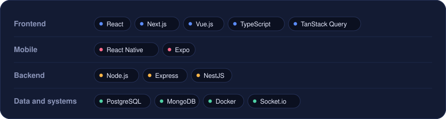

  

  
  
  

I build web and mobile products from the first sketch to the final deploy: interfaces in React and Next.js, apps in React Native, and the Node.js backends and real-time systems behind them.

## Featured work

<table>
  <tr>
    <td width="50%"></td>
    <td width="50%"></td>
  </tr>
  <tr>
    <td width="50%"></td>
    <td width="50%"></td>
  </tr>
</table>

## Tools I work with

## Get in touch

